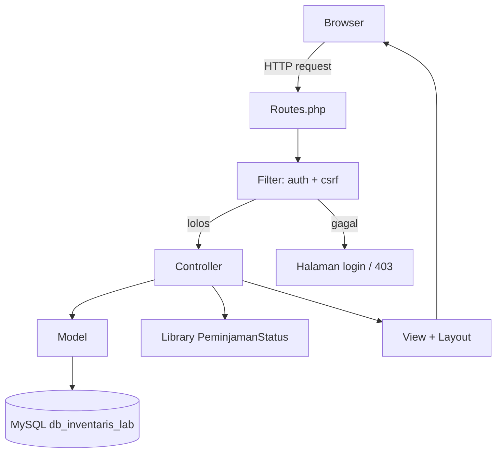
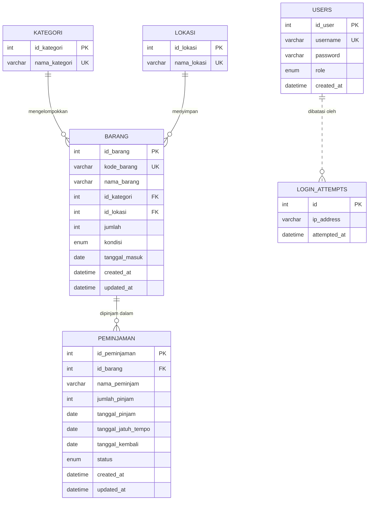
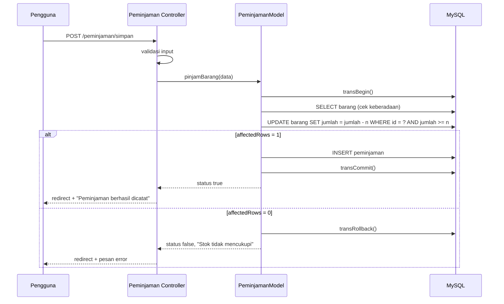
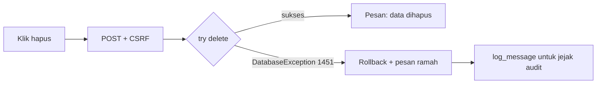

# BAHAN LAPORAN DAN DEMO — <KhazLab>

Dokumen pendukung untuk laporan akhir dan presentasi demo aplikasi **<KhazLab> (Sistem Informasi Inventaris Barang Laboratorium)**.

Isi dokumen:

1. Ringkasan aplikasi
2. Arsitektur MVC
3. ERD dan relasi tabel
4. Alur bisnis kunci (peminjaman, pengembalian, penghapusan berelasi)
5. Analisis peningkatan dibanding versi sebelumnya
6. Skrip demo 5 menit
7. Antisipasi pertanyaan penguji

---

## 1. Ringkasan Aplikasi

<KhazLab> mengelola inventaris Laboratorium Komputer: mencatat barang beserta kategori, lokasi penyimpanan, jumlah stok, dan kondisi; mencatat peminjaman dengan tanggal jatuh tempo; memulihkan stok saat pengembalian; serta menyajikan dashboard analitik dan laporan siap cetak.

| Aspek | Keterangan |
|---|---|
| Framework | CodeIgniter 4.4.8 (pola MVC) |
| Basis data | MySQL 8, 6 tabel, foreign key `ON DELETE RESTRICT` |
| Front-end | Bootstrap 5.3.3, Bootstrap Icons, Chart.js 4.4.7 |
| Autentikasi | Session + bcrypt + rate limiting 5 percobaan / 60 detik |
| Proteksi aksi | CSRF token pada semua POST, konfirmasi via modal |
| Jumlah route | 28 (12 GET halaman, 16 POST aksi) |

---

## 2. Arsitektur MVC

Pembagian tanggung jawab:

| Lapisan | Berkas | Tanggung jawab |
|---|---|---|
| Route | `app/Config/Routes.php` | Pemetaan URL ke controller, pemasangan filter `auth` dan `csrf` |
| Filter | `app/Filters/AuthFilter.php` | Menolak akses tanpa sesi login; memeriksa role |
| Controller | `app/Controllers/*.php` | Validasi input, transaksi database, memilih view, flash message |
| Model | `app/Models/*.php` | Query, join, agregasi dashboard, aturan validasi |
| Library | `app/Libraries/PeminjamanStatus.php` | Label status, kelas badge, jatuh tempo default, ambang stok menipis |
| View | `app/Views/**` | Presentasi; layout tunggal `layout/main.php` |

Alur satu request peminjaman:

1. `POST /peminjaman/simpan` -> filter `csrf` memverifikasi token, filter `auth` memverifikasi sesi.
2. `Peminjaman::store()` memvalidasi input (barang wajib ada, jumlah >= 1, jatuh tempo >= tanggal pinjam).
3. `PeminjamanModel::pinjamBarang()` membuka transaksi, mengurangi stok dengan syarat atomik, menyimpan baris peminjaman, lalu commit atau rollback.
4. Controller mengirim flash message dan redirect ke daftar peminjaman.

---

## 3. ERD dan Relasi Tabel

| Relasi | Kardinalitas | Aturan hapus |
|---|---|---|
| `kategori` -> `barang` | 1 : N | `RESTRICT` (kategori terpakai tidak bisa dihapus) |
| `lokasi` -> `barang` | 1 : N | `RESTRICT` |
| `barang` -> `peminjaman` | 1 : N | `RESTRICT` (barang beriwayat tidak bisa dihapus) |

Integritas tambahan di level database:

- `UNIQUE` pada `barang.kode_barang`, `kategori.nama_kategori`, `lokasi.nama_lokasi`, `users.username`.
- `CHECK (jumlah >= 0)` pada `barang.jumlah`.
- `CHECK (jumlah_pinjam >= 1)` pada `peminjaman`.
- Indeks `tanggal_jatuh_tempo` dan `status` pada `peminjaman`.

---

## 4. Alur Bisnis Kunci

### 4.1 Peminjaman dengan stok atomik

Poin yang ditonjolkan saat presentasi: keputusan cukup/tidaknya stok diambil oleh **database** melalui klausa `WHERE jumlah >= ?`, bukan oleh pembacaan PHP sebelumnya. Karena itu dua request bersamaan tidak dapat membuat stok minus (dibuktikan pada `PENGUJIAN.md` skenario 7).

### 4.2 Pengembalian idempoten

1. Sistem mengambil baris peminjaman dan memastikan `status` masih `Dipinjam`.
2. Dalam satu transaksi: `UPDATE peminjaman SET status='Kembali', tanggal_kembali=? WHERE id=? AND status='Dipinjam'`.
3. Bila `affectedRows() = 1`, stok dipulihkan; bila 0, permintaan dianggap pengembalian ganda dan ditolak.

Akibatnya, menekan tombol "Kembalikan" dua kali tidak pernah menggandakan stok.

### 4.3 Penghapusan data berelasi

Pesan yang ditampilkan sudah spesifik per entitas: barang beriwayat, kategori terpakai, atau lokasi terpakai.

---

## 5. Analisis Peningkatan Dibanding Versi Sebelumnya

Bagian ini yang paling sering dinilai pada laporan akhir: bukan sekadar "apa yang dibuat", tetapi "apa yang berubah dan mengapa itu lebih baik".

### 5.1 Keamanan

| Sebelum | Sesudah | Dampak |
|---|---|---|
| Hapus data lewat tautan GET | Semua aksi ubah/hapus via POST + CSRF token | Tidak bisa dipicu dari tautan atau gambar di halaman lain (CSRF) |
| Rate limiting login disimpan di session | Tabel `login_attempts` per alamat IP | Tetap berlaku lintas proses PHP dan tidak hilang saat sesi baru |
| Konfirmasi memakai `confirm()` browser | Modal Bootstrap dengan label aksi berbahasa Indonesia | Konsisten dengan tema, tidak bisa dimatikan pengguna, aksesibel |
| Error foreign key menjadi halaman crash CI4 | `try/catch DatabaseException` + pesan ramah | Pengguna paham penyebabnya; data terlindungi |

### 5.2 Integritas data

| Sebelum | Sesudah | Dampak |
|---|---|---|
| Stok dikurangi tanpa transaksi | `transBegin` / `transCommit` / `transRollback` | Tidak ada stok terpotong tanpa transaksi tercatat |
| Cek stok di PHP lalu update | `UPDATE ... WHERE jumlah >= ?` + `affectedRows()` | Stok mustahil minus walau request paralel |
| Pengembalian ganda menambah stok | Syarat `status='Dipinjam'` pada update | Stok tidak bisa digelembungkan |
| Tidak ada tanggal jatuh tempo | Kolom `tanggal_jatuh_tempo` NOT NULL + indeks | Keterlambatan dapat diukur dan ditampilkan |
| Tidak ada jaring pengaman stok | `CHECK (jumlah >= 0)` | Database sendiri menolak nilai negatif |

### 5.3 Fungsionalitas

| Sebelum | Sesudah | Dampak |
|---|---|---|
| Daftar barang tanpa pencarian | Pencarian kode/nama + filter kategori, lokasi, kondisi | Menemukan aset pada 14+ baris jadi instan |
| Tanpa pagination | Pagination server-side (`?page=n`) | Tetap ringan saat data bertambah |
| Status hanya teks | Badge otomatis `Dipinjam` / `Terlambat` / `Kembali` | Kondisi keterlambatan terbaca sekilas |
| Tidak ada dashboard analitik | Chart.js: aset vs stok, komposisi kondisi, tren 6 bulan, unit dipinjam | Mendukung keputusan pengadaan dan perawatan |
| Laporan hanya tabel HTML | Kop laboratorium, kolom tanda tangan, mode cetak, ekspor CSV | Siap diserahkan tanpa pengeditan manual |
| Tidak ada penanda stok kritis | Widget stok menipis, rusak berat, terlambat | Masalah terlihat sebelum menjadi keluhan |

### 5.4 UI/UX

| Sebelum | Sesudah | Dampak |
|---|---|---|
| Navigasi atas sederhana | Sidebar tetap + topbar dengan identitas pengguna | Orientasi lokasi jelas pada banyak modul |
| Warna default Bootstrap | Palet laboratorium/akademik terpusat di variabel CSS | Konsisten dan mudah diubah |
| Tanpa kartu statistik | Kartu ringkas pada dashboard, peminjaman, barang, laporan | Angka penting tampil sebelum tabel |
| Tabel kosong tanpa keterangan | Empty state informatif + ajakan aksi | Tidak terkesan aplikasi rusak |
| Tabel lebar memaksa scroll | Tabel responsif; tidak ada scroll horizontal di 504px | Tetap terpakai di laptop kecil |
| Alert bawaan browser | Modal konfirmasi seragam | Pengalaman konsisten |

### 5.5 Kualitas kode

- Validasi aturan barang dipusatkan: model menyediakan aturan dasar, controller menambah pengecualian id saat update. Sebelumnya, aturan `is_unique` tanpa interpolasi membuat **semua** edit barang gagal.
- Logika status dipindahkan ke `app/Libraries/PeminjamanStatus.php`, sehingga label badge dan perhitungan keterlambatan tidak diduplikasi di beberapa view.
- `downloadCsv()` dipusatkan di `BaseController`, sehingga ekspor laporan dan analitik memakai mekanisme yang sama (BOM UTF-8 + stream).

---

## 6. Skrip Demo 5 Menit

Siapkan sebelumnya: server berjalan, database hasil import `database.sql`, browser di `http://127.0.0.1:8081`, tombol **Print Preview** siap.

| Waktu | Langkah | Yang dikatakan |
|---|---|---|
| 0:00–0:20 | Buka halaman login | "<KhazLab> mengelola inventaris Laboratorium Komputer. Login memakai sesi, password bcrypt, dan pembatasan 5 percobaan gagal per 60 detik." |
| 0:20–0:45 | Salah password 6 kali | "Percobaan ke-6 diblokir. Penghitungnya disimpan di database, jadi tidak hilang walau sesi berganti." |
| 0:45–1:05 | Login `admin` / `admin123` | "Setelah berhasil, penghitung otomatis dibersihkan." |
| 1:05–1:50 | Dashboard, lalu Analitik | "Kartu ini memisahkan total aset fisik dari stok tersedia. Grafik tengah komposisi kondisi, kanan tren peminjaman enam bulan, bawah unit yang sedang dipinjam." |
| 1:50–2:35 | Menu Data Barang: ketik `monitor`, pilih kondisi `Baik`, ganti halaman | "Pencarian dan filter bekerja bersama, dan pagination dihitung di server." |
| 2:35–3:20 | Tambah peminjaman 2 unit barang stok kecil, isi jatuh tempo | "Jatuh tempo terisi otomatis 7 hari ke depan. Stok dicek dan dikurangi dalam satu transaksi database." |
| 3:20–3:50 | Coba pinjam melebihi stok | "Ditolak dengan pesan yang menyebut sisa stok. Tidak ada baris peminjaman yang tercipta." |
| 3:50–4:20 | Kembalikan transaksi tadi, lalu tekan kembalikan lagi | "Stok pulih. Percobaan pengembalian kedua ditolak karena statusnya bukan Dipinjam lagi, jadi stok tidak tergandakan." |
| 4:20–4:45 | Hapus barang beriwayat | "Ditolak dengan pesan ramah, bukan halaman error framework. Data dan riwayatnya tetap aman." |
| 4:45–5:00 | Laporan -> Cetak | "Kop laboratorium dan dua kolom tanda tangan siap dicetak atau diekspor ke CSV." |

Cadangan bila ada langkah gagal: `PENGUJIAN.md` memuat keluaran apa adanya untuk setiap skenario, sehingga dapat ditunjukkan tanpa menjalankan ulang.

---

## 7. Antisipasi Pertanyaan Penguji

**Mengapa CodeIgniter dan bukan Laravel?**
CodeIgniter 4 ringan, tidak memerlukan banyak konfigurasi awal, dan pola MVC-nya jelas untuk studi kasus inventaris. Semua yang dibutuhkan (routing, filter, model, migrasi SQL) tersedia tanpa menambah dependency.

**Mengapa stok disimpan di tabel barang, bukan tabel stok terpisah?**
Studi kasus memakai satu jenis barang dengan satu jumlah, sehingga satu kolom cukup. Pencatatan per unit (nomor seri, kondisi per unit) dicatat pada bagian Pengembangan Lanjutan di `README.md`.

**Bagaimana mencegah stok minus?**
Tiga lapis: (1) klausa `WHERE jumlah >= ?` saat `UPDATE` dalam transaksi, (2) `affectedRows()` sebagai penentu sukses, (3) constraint `CHECK (jumlah >= 0)`. Dibuktikan oleh pengujian request paralel.

**Mengapa penghapusan memakai `RESTRICT`, bukan `CASCADE`?**
Riwayat peminjaman adalah bukti pertanggungjawaban aset. `CASCADE` akan menghapus riwayat saat barang dihapus. Dengan `RESTRICT`, data historis terjaga.

**Apa yang terjadi bila dua laboran meminjam terakhir sekaligus?**
Hanya satu yang berhasil. Request kedua mendapat pesan stok tidak mencukupi karena syarat pada `UPDATE` sudah tidak terpenuhi.

**Bagaimana keamanan CSRF diuji?**
Dari `php spark routes`, seluruh route POST memakai filter `csrf`, dan setiap form dirender dengan `csrf_field()`. Request POST tanpa token ditolak framework.

**Apakah sudah ada automated test?**
Belum. Pengujian dilakukan lewat skrip HTTP terhadap server sungguhan dan hasilnya didokumentasikan apa adanya di `PENGUJIAN.md`, termasuk batas cakupannya.

**Apa keterbatasan aplikasi saat ini?**
Satu role (administrator), kondisi barang berlaku untuk seluruh unit dalam satu baris, ekspor PDF memakai print browser, belum ada notifikasi jatuh tempo, dan pembatasan login per IP sehingga pengguna di balik satu NAT berbagi kuota.

---

## 8. Berkas Pendukung

| Berkas | Isi |
|---|---|
| `README.md` | Instalasi, konfigurasi, struktur, keamanan, troubleshooting |
| `PENGUJIAN.md` | 20 skenario beserta keluaran nyata dan temuan yang diperbaiki |
| `database.sql` | Skema + data contoh laboratorium (14 barang, 20 peminjaman) |
| `docs/screenshots/` | Tangkapan layar login, dashboard, analitik, barang, peminjaman, cetak |
