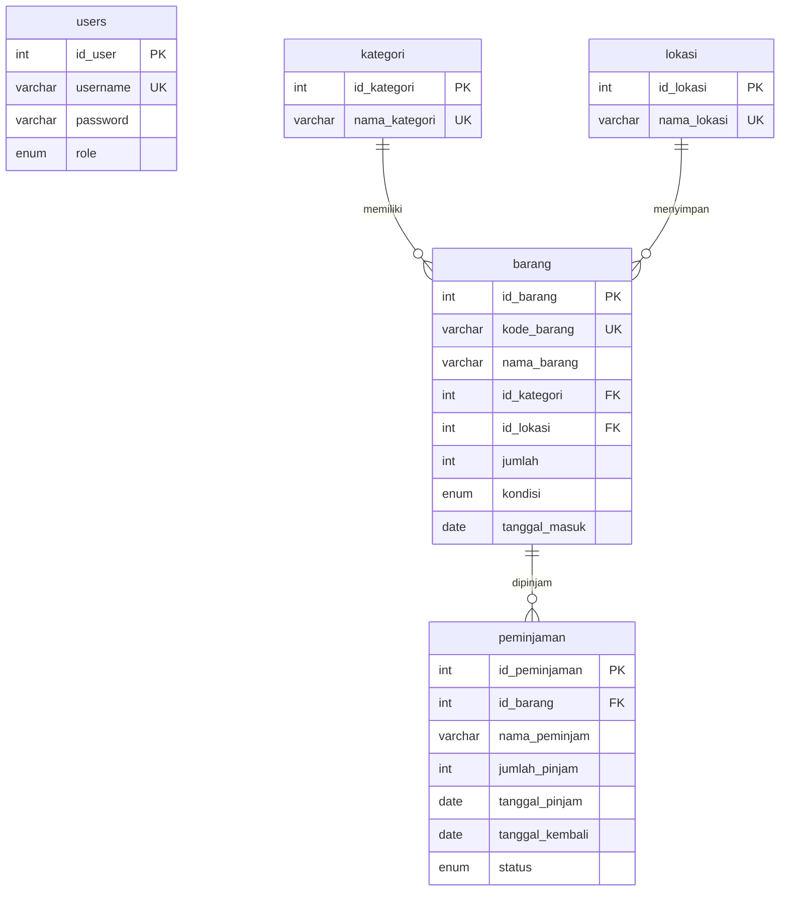

# SIM-LAB — Sistem Informasi Inventaris Barang Laboratorium

Aplikasi web untuk mengelola inventaris barang laboratorium komputer: data barang, kategori, lokasi penyimpanan, kondisi barang, peminjaman, pengembalian, dan laporan inventaris.

Project ini dibuat untuk memenuhi tugas **Praktikum Pemrograman Web Semester III** dengan studi kasus Laboratorium Komputer Program Studi Sistem Informasi, Fakultas Ilmu Komputer, UPN "Veteran" Jakarta.

## Tech Stack

- PHP 8.1+
- CodeIgniter 4.4.8 (MVC)
- MySQL / MariaDB
- Bootstrap 5.3.3 + Bootstrap Icons
- Chart.js 4.4.7
- Composer

## Fitur

| Modul | Fitur |
|---|---|
| Login | Login/logout administrator dengan session dan password hash |
| Dashboard | Ringkasan jumlah barang, stok tersedia, kondisi barang, peminjaman terbaru |
| Data Barang | Tambah, lihat, ubah, hapus, pencarian kode/nama, filter kategori/kondisi |
| Kategori | Pengelolaan kategori barang |
| Lokasi | Pengelolaan lokasi penyimpanan |
| Peminjaman | Pencatatan peminjaman dan pengurangan stok otomatis |
| Pengembalian | Pencatatan pengembalian dan pemulihan stok otomatis |
| Laporan | Rekapitulasi inventaris dengan filter dan mode cetak |

## Requirement

- PHP 8.1 atau lebih baru
- Ekstensi PHP: `intl`, `mbstring`, `mysqli`, `json`, `openssl`, `fileinfo`
- MySQL / MariaDB
- Composer (opsional, dependency sudah tersedia di folder `vendor/`)

## Cara Menjalankan

### 1. Siapkan PHP dengan ekstensi `intl`

Jika memakai PHP Laragon:

```powershell
C:\laragon\bin\php\php-8.1.10-Win32-vs16-x64\php.exe -v
C:\laragon\bin\php\php-8.1.10-Win32-vs16-x64\php.exe -m | Select-String intl
```

Jika memakai PHP XAMPP, buka `C:\xampp\php\php.ini`, cari baris berikut, lalu hapus tanda titik koma:

```ini
;extension=intl
```

menjadi:

```ini
extension=intl
```

Tutup terminal lama, buka terminal baru, lalu cek:

```powershell
php -m | Select-String intl
```

### 2. Buat file `.env`

```powershell
Copy-Item env .env
```

Sesuaikan konfigurasi utama:

```env
CI_ENVIRONMENT = development

app.baseURL = 'http://127.0.0.1:8081/'

database.default.hostname = 127.0.0.1
database.default.database = db_inventaris_lab
database.default.username = root
database.default.password =
database.default.DBDriver = MySQLi
database.default.port = 3306
```

> `app.baseURL` harus sama dengan host dan port yang dibuka di browser.

### 3. Import database

Pastikan MySQL berjalan, lalu jalankan:

```powershell
& 'C:\laragon\bin\mysql\8.0.30\bin\mysql.exe' -u root -e "source C:/laragon/www/Project_Akhir/database.sql"
```

Alternatif melalui phpMyAdmin:

1. Buka `http://localhost/phpmyadmin`
2. Pilih tab **Import**
3. Pilih file `database.sql`
4. Klik **Go**

File SQL tersebut membuat database `db_inventaris_lab`, tabel, relasi foreign key, dan data contoh.

### 4. Jalankan aplikasi

```powershell
C:\laragon\bin\php\php-8.1.10-Win32-vs16-x64\php.exe spark serve --host 127.0.0.1 --port 8081
```

Buka:

```text
http://127.0.0.1:8081
```

### 5. Login

```text
Username: admin
Password: admin123
```

## Struktur Project

```text
app/
├─ Config/          Konfigurasi CodeIgniter (Routes, App, Database, Filters, dll)
├─ Controllers/     Auth, Dashboard, Barang, Kategori, Lokasi, Peminjaman, Laporan
├─ Models/          BarangModel, KategoriModel, LokasiModel, PeminjamanModel, UserModel
├─ Views/           Layout, auth, dashboard, barang, kategori, lokasi, peminjaman, laporan
├─ Filters/         AuthFilter
└─ Database/        Folder migrations & seeds (opsional)

public/             Front controller dan .htaccess
writable/           Cache, logs, session, uploads
database.sql        Struktur database + data awal
env                 Template environment
spark               CLI CodeIgniter
```

## Relasi Database (ERD)



Catatan: kolom `jumlah_pinjam` ditambahkan pada tabel `peminjaman` agar stok dapat dihitung dan dikembalikan secara otomatis.

## Catatan Stok

Kolom `barang.jumlah` menyimpan **stok yang tersedia**. Saat barang dipinjam, stok dikurangi. Saat barang dikembalikan, stok dipulihkan. Karena itu, angka pada dashboard dan laporan diberi label **Stok Tersedia / Total Unit Tersedia**, bukan total aset fisik.

Jika ingin mencatat total aset fisik secara terpisah, tambahkan kolom `jumlah_total` atau hitung total sebagai stok tersedia + jumlah yang sedang dipinjam.

## Keamanan yang Sudah Diterapkan

- CSRF protection aktif untuk seluruh request POST.
- Logout dan aksi hapus data menggunakan method POST + CSRF token.
- Password disimpan sebagai hash bcrypt.
- Session ID di-regenerate setelah login berhasil.
- Percobaan login dibatasi 5 kali; jika gagal terus, login diblokir sementara 60 detik.
- Filter `auth` melindungi seluruh halaman administrator.

## Troubleshooting

### `php artisan serve` tidak dikenali

Project ini CodeIgniter, bukan Laravel. Gunakan:

```powershell
php spark serve
```

### `Class "Locale" not found`

Ekstensi `intl` belum aktif. Aktifkan `extension=intl` di `php.ini` atau gunakan PHP Laragon yang sudah memiliki `intl`.

### `Unknown database 'db_inventaris_lab'`

Database belum di-import. Jalankan langkah **Import database** di atas.

### Redirect terus ke `localhost:8081`

Samakan `app.baseURL` di `.env` dengan alamat yang dibuka di browser, misalnya `http://127.0.0.1:8081/` atau `http://localhost:8081/`.

### `'Select-String' is not recognized`

Perintah tersebut adalah PowerShell. Jika memakai CMD, gunakan:

```cmd
php -m | findstr intl
```

## Pengembangan Lanjutan (Opsional)

Beberapa peningkatan yang bisa ditambahkan jika project dikembangkan lebih lanjut:

- Pagination pada daftar barang, peminjaman, dan laporan untuk data yang besar.
- Export laporan ke PDF asli (misalnya dengan Dompdf), bukan hanya print browser.
- Tanggal jatuh tempo peminjaman dan status keterlambatan.
- Pencatatan kondisi per unit barang, bukan satu kondisi untuk seluruh jumlah unit.
- Automated test untuk alur login, CRUD, peminjaman, dan pengembalian.
- Role pengguna selain administrator (misalnya laboran atau pimpinan).

## Dokumentasi Pengujian

Skenario dan hasil pengujian manual tersedia di [`PENGUJIAN.md`](PENGUJIAN.md).

## Lisensi

MIT

