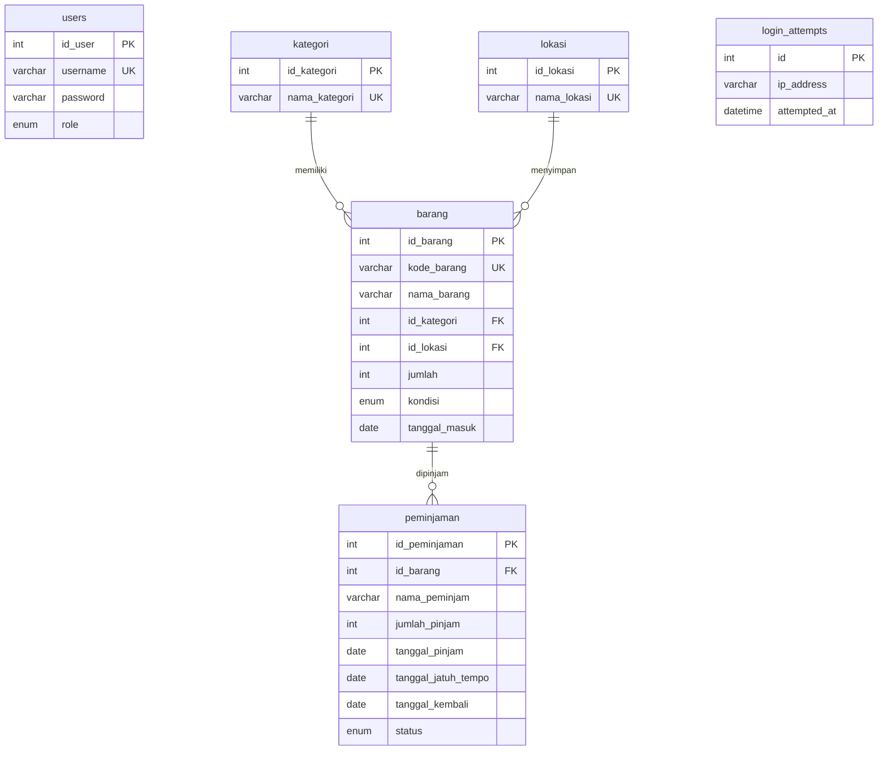

# <KhazLab> — Sistem Informasi Inventaris Barang Laboratorium

Aplikasi web pengelolaan inventaris laboratorium komputer: data barang, kategori, lokasi penyimpanan, kondisi barang, peminjaman beserta jatuh tempo, pengembalian, dashboard analitik, dan laporan siap cetak/ekspor.

Project ini dibuat untuk memenuhi tugas **Praktikum Pemrograman Web Semester III** dengan studi kasus Laboratorium Komputer Program Studi Sistem Informasi, Fakultas Ilmu Komputer, UPN "Veteran" Jakarta.

## Tech Stack

- PHP 8.1+
- CodeIgniter 4.4.8 (MVC)
- MySQL / MariaDB
- Bootstrap 5.3.3 + Bootstrap Icons 1.11.3
- Chart.js 4.4.7
- Composer

## Fitur

| Modul | Fitur |
|---|---|
| Login | Autentikasi administrator, password hash bcrypt, session ID di-regenerate setelah login, pembatasan 5 percobaan gagal per 60 detik |
| Dashboard | Kartu statistik aset, tabel stok menipis/rusak berat/terlambat, peminjaman terkini, grafik ringkas |
| Analitik | Total aset fisik vs stok tersedia, komposisi kondisi (Baik/Rusak Ringan/Rusak Berat), tren peminjaman 6 bulan, unit dipinjam per barang, ekspor CSV |
| Data Barang | CRUD, pencarian kode/nama, filter kategori/lokasi/kondisi, pagination, validasi kode unik, proteksi stok di bawah unit yang dipinjam |
| Kategori | CRUD dengan penanganan ramah saat kategori masih dipakai barang |
| Lokasi | CRUD dengan penanganan ramah saat lokasi masih dipakai barang |
| Peminjaman | Pencatatan peminjaman dengan tanggal jatuh tempo otomatis, pengurangan stok atomik dalam transaksi database, filter status/pencarian, pagination |
| Pengembalian | Pemulihan stok otomatis, idempoten (tidak menambah stok dua kali), modal konfirmasi |
| Status Otomatis | Badge `Dipinjam`, `Terlambat / Overdue`, `Kembali` dihitung dari tanggal jatuh tempo |
| Laporan | Rekap inventaris dengan filter lokasi/kondisi, kop laboratorium, kolom tanda tangan, mode cetak, ekspor CSV |
| Keamanan Aksi | Seluruh aksi ubah/hapus memakai POST + CSRF token, konfirmasi melalui modal (bukan `confirm()` browser) |

## Requirement

- PHP 8.1 atau lebih baru
- Ekstensi PHP: `intl`, `mbstring`, `mysqli`, `json`, `openssl`, `fileinfo`
- MySQL 8 / MariaDB
- Composer (opsional, dependency sudah tersedia di folder `vendor/`)

## Cara Menjalankan

### 1. Siapkan PHP dengan ekstensi `intl`

Jika memakai PHP Laragon:

```powershell
C:\laragon\bin\php\php-8.1.10-Win32-vs16-x64\php.exe -v
C:\laragon\bin\php\php-8.1.10-Win32-vs16-x64\php.exe -m | Select-String intl
```

Jika memakai PHP XAMPP, buka `C:\xampp\php\php.ini`, cari baris berikut, lalu hapus tanda titik koma:

```ini
;extension=intl
```

menjadi:

```ini
extension=intl
```

Tutup terminal lama, buka terminal baru, lalu cek:

```powershell
php -m | Select-String intl
```

### 2. Buat file `.env`

```powershell
Copy-Item env .env
```

Sesuaikan konfigurasi utama:

```env
CI_ENVIRONMENT = development

app.baseURL = 'http://127.0.0.1:8081/'

database.default.hostname = 127.0.0.1
database.default.database = db_inventaris_lab
database.default.username = root
database.default.password =
database.default.DBDriver = MySQLi
database.default.port = 3306
```

> `app.baseURL` harus sama dengan host dan port yang dibuka di browser.

### 3. Import database

Pastikan MySQL berjalan, lalu jalankan:

```powershell
& 'C:\laragon\bin\mysql\8.0.30\bin\mysql.exe' -u root -e "source C:/laragon/www/Project_Akhir/database.sql"
```

Alternatif melalui phpMyAdmin:

1. Buka `http://localhost/phpmyadmin`
2. Pilih tab **Import**
3. Pilih file `database.sql`
4. Klik **Go**

File SQL tersebut membuat database `db_inventaris_lab`, enam tabel beserta foreign key, dan data contoh laboratorium komputer (14 barang, 20 transaksi peminjaman).

### 4. Jalankan aplikasi

```powershell
C:\laragon\bin\php\php-8.1.10-Win32-vs16-x64\php.exe spark serve --host 127.0.0.1 --port 8081
```

Buka:

```text
http://127.0.0.1:8081
```

### 5. Login

```text
Username: admin
Password: admin123
```

## Struktur Project

```text
app/
├─ Config/          Konfigurasi CodeIgniter (Routes, App, Database, Filters, dll)
├─ Controllers/     Auth, Dashboard, Barang, Kategori, Lokasi, Peminjaman, Laporan
├─ Models/          BarangModel, KategoriModel, LokasiModel, PeminjamanModel, UserModel
├─ Libraries/       PeminjamanStatus (label status, badge, jatuh tempo default)
├─ Views/           Layout, auth, dashboard, barang, kategori, lokasi, peminjaman, laporan
└─ Filters/         AuthFilter

public/assets/css/  khazlab.css (tema laboratorium, dipakai semua halaman)

docs/screenshots/   Tangkapan layar untuk laporan dan demo
database.sql        Struktur database + data awal laboratorium
```

## Skema Database

Enam tabel: `users`, `kategori`, `lokasi`, `barang`, `peminjaman`, dan `login_attempts` (penunjang rate limiting login).



Aturan constraint yang dijaga database:

- `peminjaman.id_barang` -> `barang.id_barang` (`ON DELETE RESTRICT`) sehingga barang beriwayat tidak bisa dihapus.
- `barang.id_kategori` dan `barang.id_lokasi` -> `ON DELETE RESTRICT`.
- `CHECK (jumlah >= 0)` pada `barang.jumlah` sebagai jaring terakhir agar stok tidak pernah minus.
- Indeks pada `peminjaman.tanggal_jatuh_tempo` dan `peminjaman.status`.

## Catatan Stok

Kolom `barang.jumlah` menyimpan **stok tersedia**. Saat barang dipinjam, stok dikurangi; saat dikembalikan, stok dipulihkan.

Pengurangan dan pemulihan stok dijalankan di dalam transaksi database dengan syarat atomik:

```php
$db->transBegin();
$this->db->query('UPDATE barang SET jumlah = jumlah - ? WHERE id_barang = ? AND jumlah >= ?', [$jumlah, $id, $jumlah]);
if ($this->db->affectedRows() !== 1) {
    $db->transRollback();

    return ['status' => false, 'message' => 'Stok tidak mencukupi.'];
}
$this->insert([...]);
$db->transCommit();
```

Kondisi `AND jumlah >= ?` membuat database sendiri yang menolak pengurangan bila stok tidak cukup, sehingga dua request paralel tidak dapat membuat stok minus. Dashboard menampilkan **total aset fisik** (stok tersedia + unit yang sedang dipinjam) berdampingan dengan **stok tersedia**.

## Keamanan yang Sudah Diterapkan

- CSRF protection aktif untuk seluruh request POST (`csrf` filter terpasang di semua route).
- Logout serta aksi hapus/ubah memakai method POST + CSRF token; tidak dapat dipicu lewat tautan GET.
- Password disimpan sebagai hash bcrypt.
- Session ID di-regenerate setelah login berhasil.
- Percobaan login dibatasi 5 kali gagal per alamat IP dalam 60 detik; blokir dicatat pada tabel `login_attempts` sehingga tetap berlaku lintas proses, dan dihapus otomatis setelah login berhasil.
- Filter `auth` melindungi seluruh halaman administrator; role diperiksa melalui argumen filter.
- Penghapusan data berelasi menangkap `DatabaseException` dan menampilkan pesan ramah, bukan halaman error CodeIgniter.

## Pengujian

- Hasil pengujian manual lengkap: [`PENGUJIAN.md`](PENGUJIAN.md)
- Bahan laporan, ERD, dan skrip demo: [`BAHAN_LAPORAN_DAN_DEMO.md`](BAHAN_LAPORAN_DAN_DEMO.md)

Perintah verifikasi cepat:

```powershell
Get-ChildItem -Recurse app -Filter *.php | ForEach-Object { php -l $_.FullName }
php spark routes
```

## Troubleshooting

### `php artisan serve` tidak dikenali

Project ini CodeIgniter, bukan Laravel. Gunakan:

```powershell
php spark serve
```

### `Class "Locale" not found`

Ekstensi `intl` belum aktif. Aktifkan `extension=intl` di `php.ini` atau gunakan PHP Laragon yang sudah memiliki `intl`.

### `Unknown database 'db_inventaris_lab'`

Database belum di-import. Jalankan langkah **Import database** di atas.

### Redirect terus ke `localhost:8081`

Samakan `app.baseURL` di `.env` dengan alamat yang dibuka di browser, misalnya `http://127.0.0.1:8081/` atau `http://localhost:8081/`.

### `'Select-String' is not recognized`

Perintah tersebut adalah PowerShell. Jika memakai CMD, gunakan:

```cmd
php -m | findstr intl
```

### Halaman tampil tanpa warna / tanpa sidebar

CDN Bootstrap diblokir jaringan. Bootstrap, Bootstrap Icons, dan Chart.js dimuat dari `cdn.jsdelivr.net`; pastikan mesin memiliki akses internet, atau unduh aset tersebut ke `public/assets/` dan sesuaikan tautan di `app/Views/layout/main.php`.

## Pengembangan Lanjutan (Opsional)

- Pencatatan kondisi per unit barang, bukan satu kondisi untuk seluruh jumlah unit.
- Role pengguna selain administrator (laboran, pimpinan) dengan hak akses berbeda.
- Export laporan ke PDF asli di sisi server (misalnya Dompdf), bukan hanya print browser.
- Notifikasi surel otomatis untuk peminjaman yang mendekati jatuh tempo.
- Automated test (PHPUnit) untuk alur login, CRUD, peminjaman, dan pengembalian.

## Lisensi

MIT
